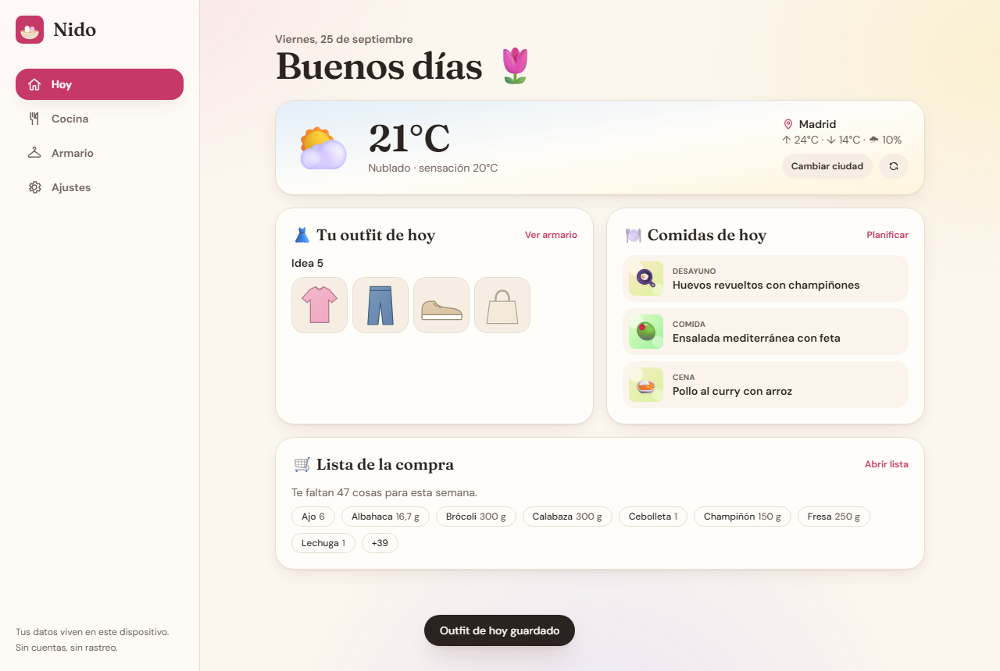
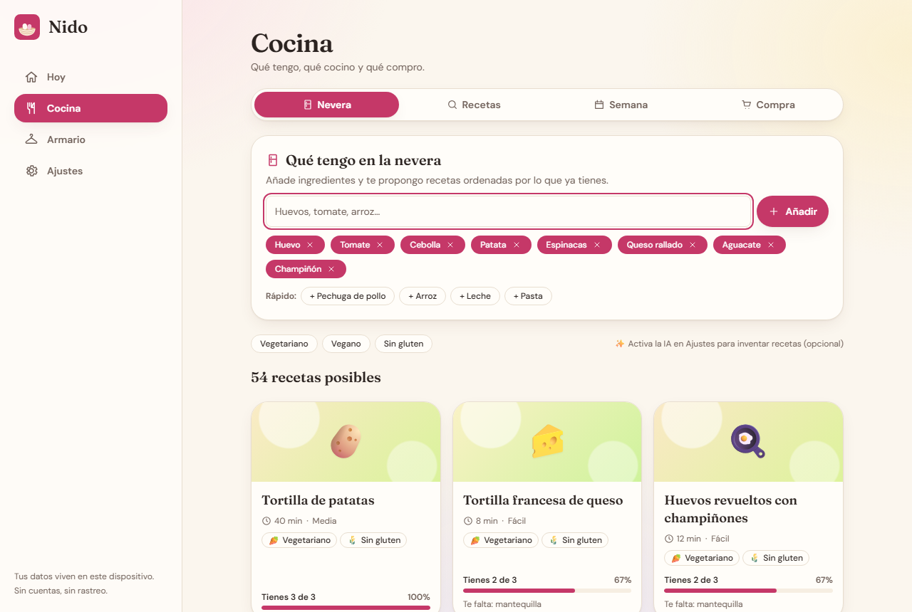
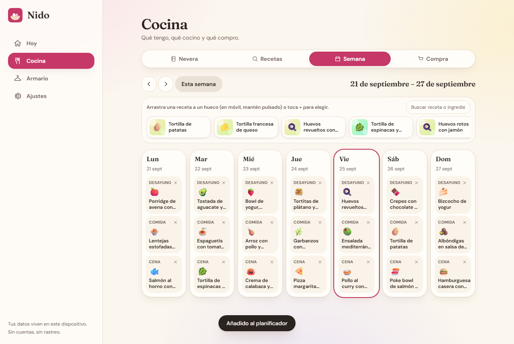
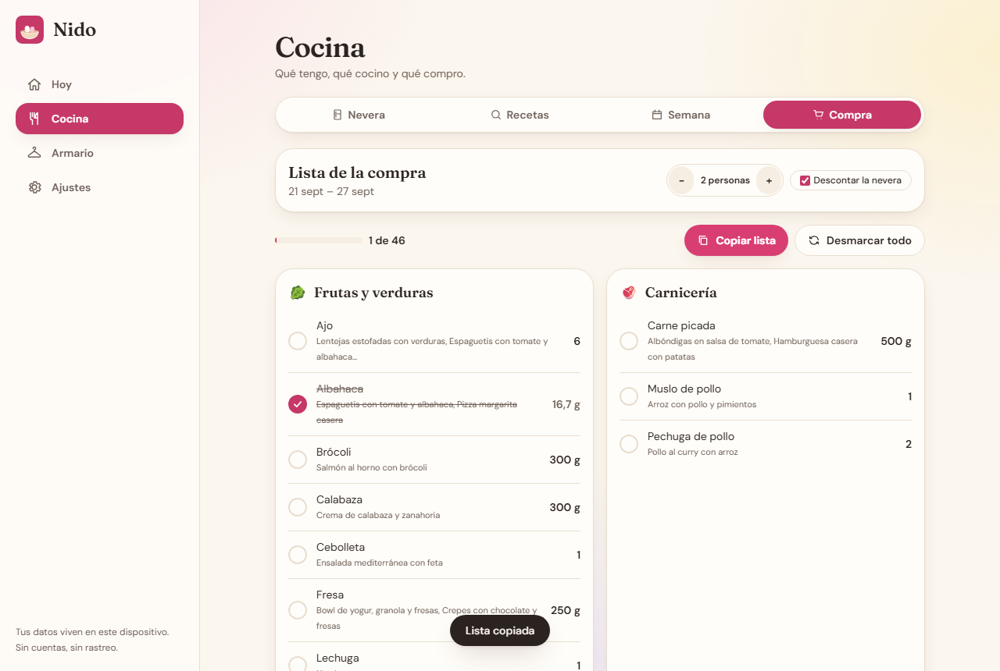
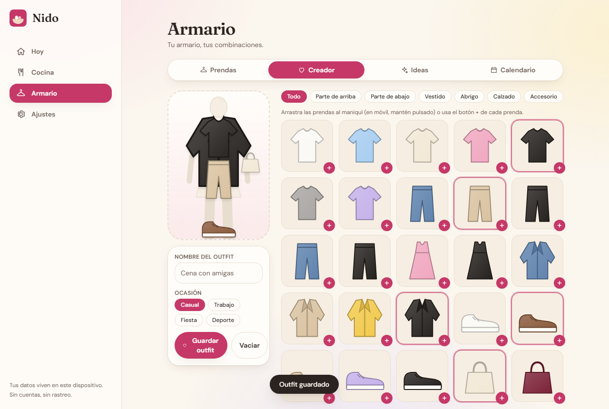
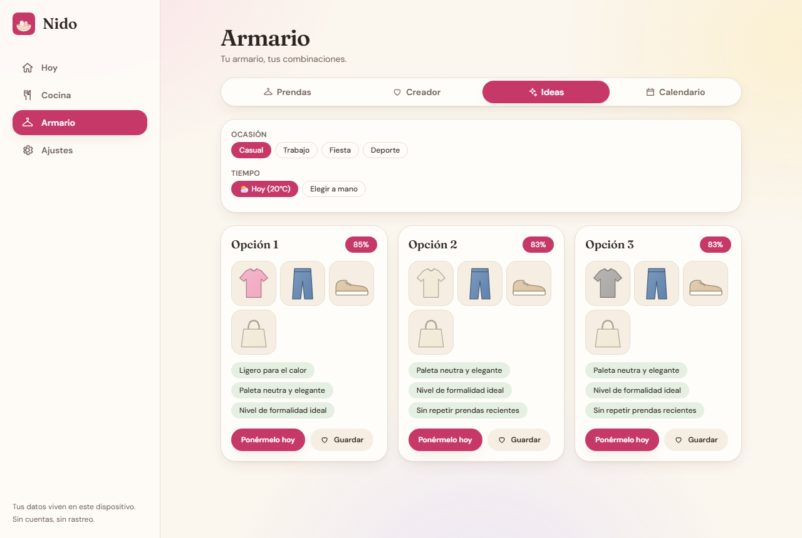
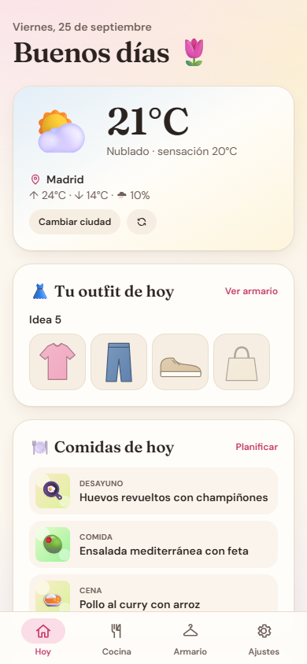
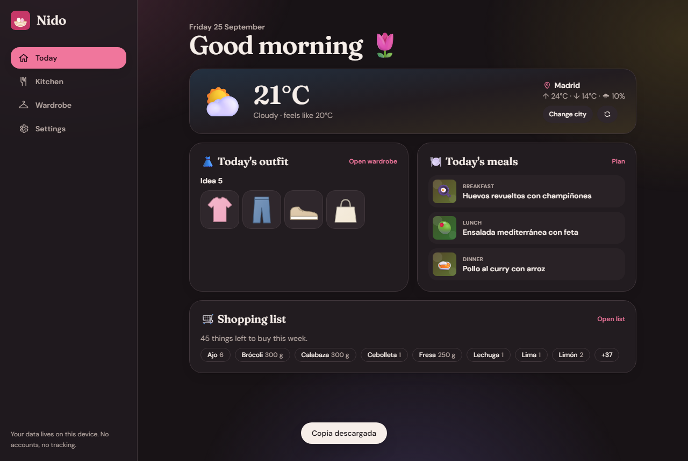

<div align="center">


# Nido

**A cozy, local-first daily planner: what to eat and what to wear, in one installable app.**

[](https://github.com/HMJ07/nido/actions/workflows/ci.yml)


</div>

Nido ("nest" in Spanish) combines a **meal planner** and a **wardrobe/outfit planner** behind one
pastel, mobile-first interface. There are no accounts, no backend, no analytics and no telemetry:
everything lives in your browser (IndexedDB). It is Spanish by default, English is one tap away, and
the AI features are strictly optional.

> Made as a gift, published as open source. Contributions and forks are welcome.

## Screenshots

Captured with Playwright against the production build (`node scripts/smoke.mjs --shots`) using the
built-in demo data. The weather is mocked in those runs so they are reproducible.

| Today                                            | Fridge to recipes                                                          |
| ------------------------------------------------ | -------------------------------------------------------------------------- |
|  |  |

| Weekly planner (drag and drop)                          | Auto shopping list                                                    |
| ------------------------------------------------------- | --------------------------------------------------------------------- |
|  |  |

| Outfit builder                                               | Outfit ideas for the weather                                          |
| ------------------------------------------------------------ | --------------------------------------------------------------------- |
|  |  |

| Mobile                                                                          | Dark mode                                       |
| ------------------------------------------------------------------------------- | ----------------------------------------------- |
|  |  |

## Features

**Hoy (Today)**

- Weather from [Open-Meteo](https://open-meteo.com) (free, no API key). Geolocation or manual city search.
- Today's outfit (the planned one, or the engine's best suggestion for today's weather).
- Today's meals and a quick shopping-list glance.

**Cocina (Kitchen)**

- "What's in my fridge": autocomplete from a built-in ingredient list, free text allowed. Recipes are
  ranked by how many ingredients you already have, and the missing ones are shown.
- 77 original recipes in Spanish (JSON dataset) with quantities, time, difficulty, and diet tags
  (vegetariano, vegano, sin gluten) derived automatically from the ingredients.
- Generated gradient and emoji cards instead of stock photos. Attach your own photo to any recipe.
- 7-day planner (breakfast, lunch, dinner) with drag and drop via [`@dnd-kit`](https://dndkit.com)
  (mouse, touch with long-press, keyboard) plus a click-to-choose alternative.
- Auto shopping list from the week's plan, minus your fridge, with quantities merged
  (2 x 200 g becomes 400 g, 1 kg + 500 g becomes 1,5 kg), grouped by supermarket section, checkable,
  scaled to the number of people, and copyable as plain text.

**Armario (Wardrobe)**

- Add garments from the camera or gallery. Photos are resized and compressed on the client and stored in
  IndexedDB. **They never leave the device.** Without a photo, a tinted illustration is generated.
- Category, colors, warmth level, formality, seasons and tags for every item.
- Outfit builder: drag garments onto a mannequin (a dress replaces top and bottom), save outfits.
- Rule-based suggestions for a given temperature, rain and occasion (casual, work, party, sport), using
  color-compatibility rules and warmth logic. Pure functions, unit tested.
- Outfit calendar that refuses to repeat the same outfit within N days.

**Ajustes (Settings)**: language, city, units (metric/imperial), light/dark/system theme, people at home,
outfit repeat window, JSON backup export/import (photos included), demo data, and optional AI.

**PWA**: installable, works offline after the first visit (small hand-written service worker).

## Privacy, honestly

- All data (recipes you add, fridge, plan, wardrobe, **photos**, outfits) is stored in your browser's
  IndexedDB. Nothing is uploaded anywhere. There is no Nido server.
- The only network requests the app makes on its own are to Open-Meteo (weather and city search), and
  they contain only the coordinates or the city name you searched for. Fonts are self-hosted at build time.
- No accounts, cookies, analytics or telemetry.
- Clearing site data deletes your data. Use **Ajustes > Exportar copia** to keep a backup.
- The optional AI is off by default. If you enable it, your browser calls the endpoint **you** configure
  directly. The API key is kept in `localStorage` only, is never included in exports, and is sent only to
  that endpoint. Prompts contain ingredient names or garment names, not photos.

## Optional AI assist

Configure any OpenAI-compatible `/chat/completions` endpoint in **Ajustes**: base URL, model and key
(Ollama works with `http://localhost:11434/v1`, no key). Used for:

1. inventing a recipe from your fridge contents, and
2. explaining a suggested outfit in a friendly sentence.

Without configuration the AI buttons are hidden and a hint points to Ajustes. Network and CORS errors are
reported in plain language. For Ollama, start it with `OLLAMA_ORIGINS=*` (or this site's origin).

## Quick start

[](https://picorunner.com/launch/?repository=https%3A%2F%2Fgithub.com%2FHMJ07%2Fnido)

```bash
git clone https://github.com/HMJ07/nido.git
cd nido
npm install
npm run dev        # http://localhost:3000
```

Requires Node.js 20 or newer. The commands are identical on Windows (PowerShell), macOS and Linux.

| Command          | What it does                                                                      |
| ---------------- | --------------------------------------------------------------------------------- |
| `npm run dev`    | Development server                                                                |
| `npm run build`  | Static export to `out/`                                                           |
| `npm start`      | Serve `out/` locally (`npx serve out`)                                            |
| `npm run lint`   | ESLint and `tsc --noEmit`                                                         |
| `npm test`       | Vitest unit tests                                                                 |
| `npm run e2e`    | Playwright smoke test against `out/` (run `npx playwright install chromium` once) |
| `npm run format` | Prettier                                                                          |

## Inicio rápido (español)

1. Instala [Node.js 20+](https://nodejs.org).
2. Abre una terminal en la carpeta del proyecto y ejecuta `npm install` y luego `npm run dev`.
3. Abre <http://localhost:3000> y pulsa **Cargar datos de ejemplo** para verlo todo en marcha.
4. Para instalarla como app en el móvil, publícala (ver abajo) y usa "Añadir a pantalla de inicio".
5. Haz copias de seguridad desde **Ajustes > Exportar copia**: tus datos solo viven en tu dispositivo.

## Deploy (free, static)

Nido is a static export (`output: "export"`): any static host works and no environment variables are required.

- **Netlify**: import the repo. `netlify.toml` already sets `npm run build` and publish dir `out`.
- **Vercel**: import the repo. The Next.js preset detects the static export automatically.
- **GitHub Pages**: build with the repository name as base path and publish `out/`:
  ```bash
  NEXT_PUBLIC_BASE_PATH=/nido npm run build   # PowerShell: $env:NEXT_PUBLIC_BASE_PATH="/nido"; npm run build
  ```
  then publish the `out/` folder (for example with a `gh-pages` branch or a Pages workflow).

## Architecture

```
src/
  app/                 Next.js App Router pages (/, /cocina, /armario, /ajustes), layout, global CSS
  components/          UI (React). AppProvider holds state and talks to the repository
    kitchen/           Fridge, recipe browser/detail, planner (dnd-kit), shopping list
    wardrobe/          Closet, item form, mannequin builder, suggestions, outfit calendar
  lib/                 Pure logic, no React (this is what the tests cover)
    recipes/           catalog.ts (ingredients, sections, diet flags), match.ts (ranking), data/recipes.json
    shopping/          units.ts (conversion, formatting), build.ts (merge + fridge subtraction), text.ts
    outfits/           colors.ts (compatibility), engine.ts (suggestions), compose.ts, calendar.ts
    weather/           Open-Meteo client and parsing
    storage/           repository.ts (IndexedDB + in-memory), backup.ts (export/import), image.ts, schema.ts
    ai/                Optional OpenAI-compatible client, prompts and answer parsing
    i18n/              es.ts (source of truth) and en.ts (same keys, enforced by types and tests)
    seed.ts            Demo wardrobe, outfits and week
public/                Manifest, icons, hand-written service worker
tests/                 Vitest suites
scripts/               icons.mjs (PNG icons) and smoke.mjs (Playwright end-to-end)
```

Design notes:

- **Local-first with a repository seam.** The UI only talks to the `Repository` interface, implemented by
  `IdbRepository` (via [`idb`](https://github.com/jakearchibald/idb)) and `MemoryRepository`. Tests run the
  export/import round trip against both (IndexedDB through `fake-indexeddb`).
- **Pure engines.** Recipe ranking, shopping-list merging and outfit suggestion are deterministic pure
  functions. The outfit engine enumerates every valid combination (dress, or top + bottom) x shoes x optional
  outer layer, scores warmth fit, color harmony, formality and occasion, then returns distinct suggestions.
- **Diet tags are derived**, not hand-typed, from flags on the ingredient catalog.
- **Service worker**: same-origin GET only, cache-first for hashed assets, network-first for pages.
  Third-party requests (weather, AI) are never cached.

## Adding recipes

Recipes live in [`src/lib/recipes/data/recipes.json`](src/lib/recipes/data/recipes.json). Add an object:

```json
{
  "id": "tortilla-patata",
  "name": "Tortilla de patatas",
  "emoji": "🥔",
  "hue": 42,
  "meals": ["lunch", "dinner"],
  "time": 40,
  "difficulty": "medio",
  "servings": 4,
  "ingredients": [
    "6 u huevo",
    "500 g patata",
    "1 u cebolla",
    "100 ml aceite de oliva",
    "1 pizca sal"
  ],
  "steps": ["Pela y corta las patatas...", "Escurre y mezcla...", "Cuaja por ambos lados."]
}
```

- `id` must be unique. `meals` is any of `breakfast`, `lunch`, `dinner`. `difficulty` is `facil`, `medio` or `dificil`.
- `hue` (0 to 360) colors the generated card. `emoji` is its centerpiece.
- Ingredients are `"<quantity> <unit> <name>"` with units `g, kg, ml, l, cl, u, cda, cdta, pizca`.
- The **name must exist** in [`catalog.ts`](src/lib/recipes/catalog.ts) (add it there with its supermarket
  section and flags: meat, fish, animal-derived, gluten, staple). A test fails if a recipe uses an unknown ingredient.
- `diet` is optional; when omitted it is derived from the ingredient flags.
- Write your own text: do not copy recipes from other websites.

## Roadmap

- [ ] Pantry quantities in the fridge UI (the shopping engine already supports them)
- [ ] Nutritional info per recipe
- [ ] Drag-to-reorder and copy/paste of whole days in the planner
- [ ] Background removal for wardrobe photos (on-device)
- [ ] More languages for recipe content
- [ ] Optional encrypted sync between devices (bring-your-own storage)
- [ ] Packing lists and a trip planner using the wardrobe

## Contributing and security

See [CONTRIBUTING.md](CONTRIBUTING.md) and [SECURITY.md](SECURITY.md). Released under the [MIT License](LICENSE).
